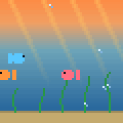
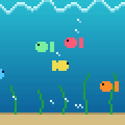
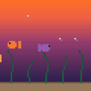
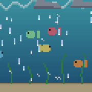
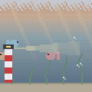
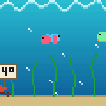

# GeekMagic SmallTV-Ultra - Pixel aquarium with live weather

  
  
  
  

Morning, day, evening and night, picked by sunrise and sunset at your location.

  
  
  

Rain, fog, and the outdoor temperature delivered by a crab, a submarine and an octopus.

- Four scenes switch with the part of the day at your location: sunrise, day, dusk and night. Dawn, sunrise, sunset and dusk are computed on the device, no server involved.
- The current weather shows up in the scene: a cloud bank drifts over the surface, rain falls, snow covers the sand and a snowman appears, fog brings a lighthouse, thunder flashes, and clear nights have stars. Fetched from Open-Meteo every 15 minutes, drawn as a few hundred pixels over the animation, no extra files.
- The current outdoor temperature travels through the scene on a sign carried by a crab, on the hull of a submarine, on a puffer fish's belly, on a gold plate from a treasure chest, in a message in a bottle, written in octopus ink, as bait on a fishing hook, on a sunken neon sign or held up by a crab parade. Three of them are on duty each day, drawn anew every morning at four, and take turns, never more than a few seconds out of view. There are a few more things to discover if you keep watching. 😉
- Animations use PXA, a small run-length encoded format with a palette and raw frames. The ESP8266 has about 25 KB of free RAM, far too little for a GIF decoder, so this player needs about 6 KB instead.
- Make your own animations with `tools/pxa.py`: it renders the bundled scenes, converts small GIFs and renders a `.pxa` back to GIF for checking.
- Everything is configured in `config.json`: API token, location, timezone, which file plays in which phase. Switch scenes or files at runtime through `POST /api/v1/screen`.
- Flashing works over WiFi from the stock firmware, no cables. Step by step in [docs/flashing.md](docs/flashing.md), including rescue mode if something goes wrong.
- Based on [Times-Z/GeekMagic-Open-Firmware](https://github.com/Times-Z/GeekMagic-Open-Firmware), which provides WiFi setup, OTA updates, the web UI and the rescue mode.

## Compatibility

| Device | Status |
|---|---|
| GeekMagic SmallTV-Ultra (ESP8266, 1.5" ST7789 240x240), stock firmware V9.0.x | Tested, this is what the aquarium runs on |
| GeekMagic HelloCubic Lite | Supported by the upstream firmware, the aquarium is untested there |

Flashing works over WiFi from the stock firmware (`http://<device-ip>/update`), no cable and no soldering. A USB-to-serial adapter on the PCB pads is the fallback. Make a backup of your flash first; factory images are in [backup/](backup/readme.md).

## Getting started

1. Build the firmware and the filesystem image with PlatformIO or the Docker image, see [docs/flashing.md](docs/flashing.md).
2. Copy `data/config.example.json` to `data/config.json` and fill in token, WiFi and location. Every key is explained in the flashing guide.
3. Flash over WiFi from the stock firmware, then upload the filesystem image. Done: the aquarium appears and follows your sun and weather.

Switch scenes, test weather and figures or tune colours at runtime through `POST /api/v1/screen`; the flashing guide lists the calls.

## Documentation

- [docs/flashing.md](docs/flashing.md): build, config keys, flashing from the stock firmware, OTA updates, runtime API, rescue.
- [docs/rescue-mode.md](docs/rescue-mode.md): what the rescue boot mode does and its API.
- [docs/hardware.md](docs/hardware.md): teardown, pinout, SPI and the ST7789 init sequence.
- `tools/pxa.py`: render the scenes, convert small GIFs to PXA, render PXA back to GIF.

## License and credits

GPLv3, see [LICENSE](LICENSE). Built on [Times-Z/GeekMagic-Open-Firmware](https://github.com/Times-Z/GeekMagic-Open-Firmware), which did the hardware reverse engineering, the WiFi and OTA plumbing, the web UI and the rescue mode. Thank you.
